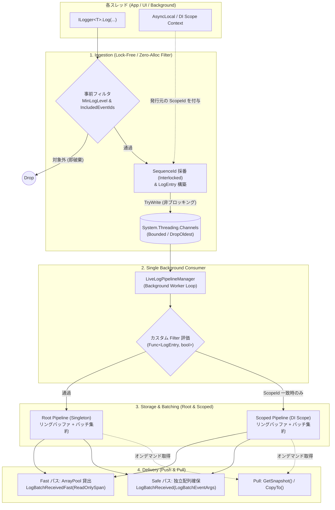

# LiveLogPipeline設計書

## UseCase検討

Primary(自分の必要性)

- Generic Host 上で動作するデスクトップ・クライアントアプリ（WPF等）において、Microsoft.Extensions.Logging（ILogger）経由で発行されたログを一時的なリングバッファに安全に蓄積し、UI のログ表示画面や診断ビューワーへ高スループット・低アロケーションでバッチ配信するデータパイプライン

----

Second

- 障害・クラッシュ時の「直近ログのスナップショット取得（Pull型）」
- ヘッドレスサービス（Web/Blazor/CLI）におけるリアルタイムストリーミング
- CI/CD や結合テストでのログキャプチャ

## Requirements検討

### 蓄積・データ構造 (Ingestion & Storage)

- `Microsoft.Extensions.Logging` の `ILogger` からのログデータを直近 N 件までインメモリに保管する。
  - バッファ上限（MaxCapacity）超過時は、最も古いエントリから自動破棄（DropOldest 循環）する。
- 書き込みの Lock は厳禁。ロックフリー指向の設計とする。
  - `ILogger.Log` 呼び出しはロックフリー（`System.Threading.Channels` の非ブロッキング書き込み）を前提とし、呼び出し元スレッドを一切ブロックしない。
  - 初期フェーズでは実装コストと安全性を優先し、内部バッファ（Channel）経由の単一 Consumer 集約パイプライン構成とする。
  - 将来的な最適化（$2^n$ シーケンス配列直書き）への差し替えを見据え、外部インターフェース（`ILiveLogPipeline`）は内部構造に依存しない設計とする。
- 保持する`LogEntry`レコードは値型想定

### 読み出し・配信 (Consumption & Delivery)

- 保管されたログデータを取り出すことができる（Pull および Push の両対応）。
  - **Push（リアルタイム配信）**:
    - 定周期バッチ集約（Periodic Batching / Throttle: 最大遅延時間 N ms または 最大保持件数 M 件に達したらフラッシュ）を基本とし、オプションとして `Debounce`（ログ静止時のみフラッシュ）への切り替えを可能とする
    - 時間経過やタイマー駆動の処理は、決定論的かつ高速な単体テストを実現するため、すべて `TimeProvider`（.NET 8+）経由で実行すること。
  - **Push における取り出しメモリ方針**:
    - Mode A (Delta): 直前の通知からの更新分のみを取得
      - Fast パス (Zero-Allocation):
        - コールバックに `ReadOnlySpan<LogEntry>` を使用し、非同期持ち出しを言語仕様（ref struct）で物理的に遮断。
        - 通知用バッファは `ArrayPool<LogEntry>` を活用し、イベント終了直後にライブラリが自動回収する。
      - ~~Safe パス (Async/Dispatcher 互換)~~:
        - ~~非同期処理や Dispatcher.InvokeAsync への安全な引き渡しを目的とし、バッチごとの独立配列（`LogEntry[]` / `ReadOnlyMemory<LogEntry>`）生成を許容する。~~
        - Safeパスについては、Pull側に統合
    - Mode B (Snapshot): 通知時点のバッファ内全件を取得（低頻度な同期利用または明示的なスナップショット配列生成とする）。
  - **Pull（オンデマンド取得）におけるメモリ方針**:
    - 手軽な取得用: 呼び出し時に新しいスナップショット配列を生成して返却（`LogEntry[] GetSnapshot()`）。
      - 非同期処理や Dispatcher.InvokeAsync への安全な引き渡しを目的とし、バッチごとの独立配列（`LogEntry[]`）生成を許容する。
    - ゼロアロケーション用: 呼び出し側が渡したバッファへ直接書き込み（`int CopyTo(Span<LogEntry> destination)`）。

### フィルタリングと開発者体験 (Filtering & DX)

- ログのフィルタリングが可能となり、インメモリに保存する対象範囲を指定できること（`CategoryName`, `LogLevel`, `EventId` 等）。
- 開発用ログとユーザー向けログを別々の `ILogger` インスタンスに分けて実装しなくてよいこと。
  - 単一の `ILogger<T>` から発行されたログに対し、`EventId` 等のタグを用いてインメモリ保存対象を透過的に選別できること。
- `Microsoft.Extensions.Logging` の Provider 独立フィルタ機能および本ライブラリ固有の Options（`EventIdFilter` 等）により、ファイル出力（FileLogger）など他のログプロバイダの設定や動作と相互に干渉・依存しないこと。

### 構成・設定 (Configuration)

- 保管上限件数、バッチフラッシュ間隔、フィルタ条件などを `appsettings.json`（Options パターン）やコードから設定可能とする。

### 責務境界とメモリライフサイクル

- **LiveLogPipeline の責務**:
  - インメモリバッファの容量（MaxCapacity = N）を厳密に保証し、超過時は DropOldest で自動破棄する。
  - 外部への Push 通知は設定された配信モード（Delta または Snapshot）に従って安全にディスパッチし、自身のメモリ使用量を一定（O(1)）に保つ。
- **UI / Consumer の責務**:
  - UI 側の表示リスト（`ObservableCollection` 等）の肥大化を防ぐため、UI 側での最大表示件数（TrimExcess）の制御は ViewModel / UI 側の責務とする。
  - （例: UI 側でバッチ差分を追加後、`while (Logs.Count > MaxViewCount) Logs.RemoveAt(0);` を行う運用を標準とする）

### サービスライフタイムとスコープ分離要件

- **Root（Singleton）パイプライン**:
  - アプリケーション全体のログを集約・保持する `ILiveLogPipeline` を提供すること。
- **Scoped パイプライン**:
  - 特定の画面（Window / Tab）や業務セッションの生存期間に連動する `IScopedLiveLogPipeline` を提供すること。
  - スコープの Dispose と連動して、内部バッファおよび購読が自動的に解放・クリーンアップされること。
- **ログのルーティング**:
  - スコープ内で発生したログは、原則として「Scoped パイプライン」と「Root パイプライン」の双方に安全に配信されること。

## PublicAPI検討

### `LogEntry`

```csharp
public readonly record struct LogEntry(
    long SequenceId,          // 一意連番（内部制御兼、行キー）
    DateTimeOffset Timestamp, // 発生日時
    LogLevel LogLevel,        // ログレベル
    EventId EventId,          // フィルタ・タグ用
    string Category,          // 出力元クラス名など
    string Message,           // フォーマット済み本文
    Exception? Exception = null,
    int ManagedThreadId = 0);
```

`long SequenceId`については、ユーザには不要ではあるが、内部実装上必須であることと、ユーザに不利になる要素がほぼないことからPublicにする。特にInternalにするまでの必要性はないと考える。

### `ILiveLogPipeline`

```csharp
namespace LiveLogPipeline;

/// <summary>
/// インメモリログの蓄積、リアルタイムバッチ通知（Push）、オンデマンド取得（Pull）を提供するパイプライン。
/// </summary>
public interface ILiveLogPipeline : IDisposable
{
    // =========================================================================
    // 状態・メタデータ
    // =========================================================================

    /// <summary>現在バッファ内に保持されている有効なログ件数を取得します。</summary>
    int Count { get; }

    /// <summary>バッファの最大保持可能件数（Capacity）を取得します。</summary>
    int Capacity { get; }

    // =========================================================================
    // Push 型（リアルタイム配信）
    // =========================================================================

    /// <summary>
    /// [Safe パス] 定周期バッチごとに新着ログを通知するイベント。
    /// 配列は独立して割り当てられているため、UI スレッド（Dispatcher.InvokeAsync）や非同期タスクへ安全に渡せます。
    /// </summary>
    event Action<LogBatchEventArgs>? LogBatchReceived;

    /// <summary>
    /// [Fast パス] 定周期バッチごとに新着ログを通知するゼロアロケーションイベント。
    /// ReadOnlySpan を引数に取るため非同期への持ち出しは言語仕様（ref struct）で遮断され、
    /// ハンドラ完了直後にバッファが即座に回収・再利用されます。
    /// </summary>
    event LogBatchSpanAction? LogBatchReceivedFast;

    // =========================================================================
    // Pull 型（オンデマンド取得）
    // =========================================================================

    /// <summary>
    /// 現在バッファに保持されているすべてのログエントリの配列スナップショットを取得します。
    /// </summary>
    /// <returns>時系列順に並んだログエントリの新規配列。</returns>
    LogEntry[] GetSnapshot();

    /// <summary>
    /// 現在バッファに保持されているログエントリを、呼び出し元が用意したバッファへ直接コピーします（アロケーションフリー）。
    /// </summary>
    /// <param name="destination">コピー先の Span 領域。</param>
    /// <returns>実際に書き込まれたログ件数。</returns>
    int CopyTo(Span<LogEntry> destination);
}

/// <summary>
/// Fast パス用のデリゲート（ref struct を渡すため言語仕様上必須）。
/// </summary>
public delegate void LogBatchSpanAction(ReadOnlySpan<LogEntry> entries);

/// <summary>
/// Safe パス用のイベント引数。
/// </summary>
public readonly record struct LogBatchEventArgs(
    ReadOnlyMemory<LogEntry> Entries
);

/// <summary>
/// 特定のスコープ（画面・セッション）に閉じたログのみを蓄積・配信するパイプライン。
/// スコープの破棄（Dispose）と連動して購読やバッファが解放されます。
/// </summary>
public interface IScopedLiveLogPipeline : ILiveLogPipeline
{
    // 固有プロパティは何も持たせない！
    // （ILiveLogPipeline と同じ操作ができるが、Scoped ライフタイムであることを型で表現する）
}
```

- Note
  - `Clear()`もありかと考えたが、ユースケース上ログを消す用途がないと考えたため初版では不要。
    - 特に実装コストの上昇もあるのでメリットが薄いと考える。
  - `GetSnapshot();`の返り値については、`ReadOnlyMemory<LogEntry>`案もあるが、実用上`LogEntry[]`のほうが使いやすい
    - 表示用Log配列の初期値として使えるのは一般的に`LogEntry[]`になる。`ReadOnlyMemory`は`IEnumerable`を実装していないため。

### Options

```csharp
namespace LiveLogPipeline;

public sealed class LiveLogOptions
{
    // =========================================================================
    // 1. バッファ・容量
    // =========================================================================

    /// <summary>
    /// インメモリに保持する最大ログ件数（デフォルト: 1000）。
    /// 上限超過時は DropOldest（最も古いログから自動破棄）されます。
    /// </summary>
    public int MaxCapacity { get; set; } = 1000;

    // =========================================================================
    // 2. バッチ・フラッシュ
    // =========================================================================

    /// <summary>
    /// バッチ通知を行う間隔（デフォルト: 100ms）。
    /// </summary>
    public TimeSpan FlushInterval { get; set; } = TimeSpan.FromMilliseconds(100);

    /// <summary>
    /// 時間経過を待たずに即座にフラッシュを行う最大保持ログ件数（デフォルト: 100）。
    /// </summary>
    public int MaxBatchSize { get; set; } = 100;

    /// <summary>
    /// バッチ集約のモード（デフォルト: Periodic）。
    /// </summary>
    public BatchMode Mode { get; set; } = BatchMode.Periodic;

    // =========================================================================
    // 3. フィルタリング
    // =========================================================================

    /// <summary>
    /// 最小ログレベル（デフォルト: LogLevel.Information）。
    /// </summary>
    public LogLevel MinLogLevel { get; set; } = LogLevel.Information;

    /// <summary>
    /// 保存対象とする EventId.Id のホワイトリスト。
    /// null または空の場合はすべての EventId を通します。
    /// appsettings.json からの [ 1001, 1002 ] バインドに対応します。
    /// </summary>
    public HashSet<int>? IncludedEventIds { get; set; }

    /// <summary>
    /// コードから柔軟にフィルタリングを行うための判定デリゲート（オプション）。
    /// </summary>
    public Func<LogEntry, bool>? Filter { get; set; }
}

public enum BatchMode
{
    Periodic,
    Debounce
}
```

- note
  - `Filter`の使用ケース
    1. 「特定のカテゴリ（クラス）だけログレベルを下げる」動的制御
    2. 特定メッセージのノイズ除去（ブラックリスト / 無視）
    3. 特定の例外（Exception）型に応じた選別
    4. スレッドや実行コンテキストによる選別
  - ただし、ログごとの評価になるので十分に早い同期コードであることを前提にユーザ側に実装してもらう想定

### HostExtensions

```csharp
namespace Microsoft.Extensions.Logging;

public static class LiveLogLoggingBuilderExtensions
{
    /// <summary>
    /// LiveLogPipeline をロギングパイプラインおよびサービスコンテナに登録します。
    /// </summary>
    public static ILoggingBuilder AddLiveLogPipeline(
        this ILoggingBuilder builder,
        Action<LiveLogOptions>? configure = null);
}
```

## DataFlow検討



- Note
  - ScopeIDはPublicAPIとしては公開しないように決めているが、LoggerがSingltonになるようになっているので、どうしてもScope情報が消えてしまう。この情報を受け渡す構造が必要であり、今回は`AsyncLocal<T>`を使う。
  - `AsyncLocal<T>`はライブラリ向けのやべえ機能なので[TIPS](note/async-local-tips.md)にメモを入れた
